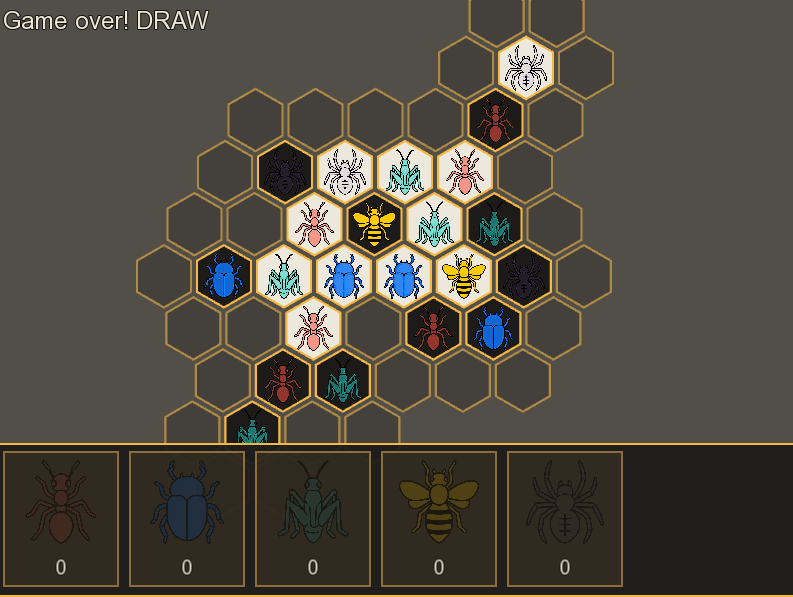
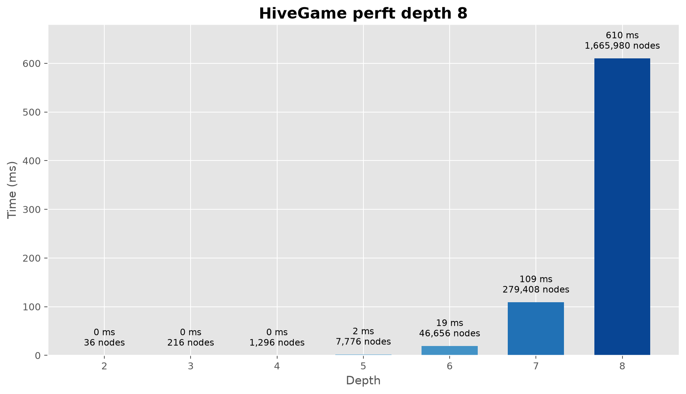

# Hive board game implementation (C++23)

This repository contains a modern C++23 implementation of the board game Hive with a local GUI, a rules engine, a TCP client/server layer, and a non-trivial AI opponent.
The project follows the game rules closely, is heavily tested, and keeps move generation fast enough for real search work.


## What is implemented

- full Hive rules engine in C++23
- local game UI in SFML
- player-vs-player and player-vs-AI modes
- alpha-beta AI with heuristic evaluation
- perft-style benchmarking for search and move generation
- TCP client/server support
- official move notation support
- replay / viewer tooling for recorded games

## Architecture

The code is split into a small number of clear layers:

```text
+-------------------+
| GUI / App         |
| SFML window, menu, input, controller |
+---------+---------+
          |
          v
+-------------------+
| Engine            |
| Game, Board, ActionHandler, rules logic |
+---------+---------+
          |
          v
+-------------------+
| AI                |
| AlphaBetaAI, heuristic evaluation      |
+-------------------+
```

At a domain level:

- Board owns the board state and adjacency rules.
- ActionHandler generates and validates legal actions.
- Game owns turn flow, history, and game-over status.
- AI evaluates candidate moves and applies search over legal continuations.
- GUI is intentionally thin and delegates gameplay to the engine.

## Repository layout

```text
app/               GUI entrypoint and menu flow
ai/                AI search and heuristic logic
ai_tests/          AI benchmarking and search scenarios
client/            client-side network demo code
docs/              architecture, quality, performance notes
engine/            main game engine
gameViewer/        replay / visualization utility
gui/               SFML game controller and drawable layer
scripts/           analysis and benchmark helpers
server/            server demo / multiplayer host
tests/             unit and regression tests
```

## Requirements

- CMake 3.20+
- C++23 compiler
- SFML 2.x
- GTest

## Build

```bash
cmake -S . -B build -DCMAKE_BUILD_TYPE=Release
cmake --build build -j
```

The main executable is built as:

```bash
./build/app/HiveGame
```

## Run the game

Local game:

```bash
./build/app/HiveGame
```

## Tests

The project includes both deterministic logic tests and randomized robustness checks.

Run the complete suite:

```bash
ctest --test-dir build --output-on-failure
```

Or run a specific test binary directly if desired:

```bash
./build/tests/test_GameLogic
```

The regression coverage includes dedicated tests for each piece type, action parsing, full official-game playthroughs, and randomized smoke tests over many legal games.


## AI and performance

The search layer is designed around legal move generation and minimax-style pruning. The AI uses the project’s own move generator, so search quality depends on the same rules engine that powers the game itself.
Hot paths use fixed-capacity static containers where it makes sense, which keeps allocations low and move generation fast.

Performance is measured with perft-like runs and AI benchmark helpers in the project:

```bash
./build/ai_tests/AiTester perft 8
```

Current branch results:

- depth 2: 36 nodes, 0 ms
- depth 3: 216 nodes, 0 ms
- depth 4: 1,296 nodes, 0 ms
- depth 5: 7,776 nodes, 2 ms
- depth 6: 46,656 nodes, 19 ms
- depth 7: 279,408 nodes, 109 ms
- depth 8: 1,665,980 nodes, 610 ms
- total runtime: 1.056 s real

